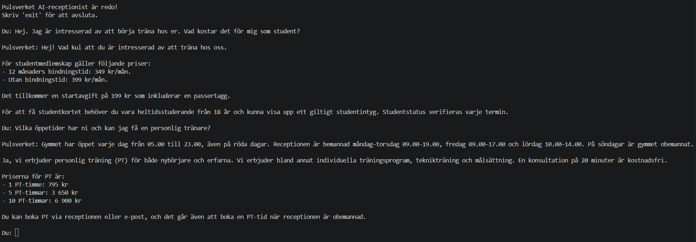

# Pulsverket – Local AI Gym Receptionist

A simple Python chatbot powered by Ollama and a locally running LLM.

The chatbot acts as a virtual receptionist for **Pulsverket**, a fictional gym. It answers customer questions about memberships, pricing, opening hours, personal training, group classes, and gym policies using a collection of Markdown documents.

## Demo (Screenshot)



## Features

- Runs locally using Ollama (`gemma4:26b`)
- Uses a customizable system prompt
- Reads multiple Markdown files as its knowledge base
- Maintains conversation history
- Streams responses directly to the terminal
- Automatically downloads the model if needed
- No external Python dependencies

## Project structure

```text
├── main.py
├── system_prompt.md
├── knowledge/
│   ├── 01-gymmet.md
│   ├── 02-medlemskap.md
│   ├── 03-betalning-avtal.md
│   ├── 04-grupptraning.md
│   ├── 05-personlig-traning.md
│   └── 06-ordningsregler.md
└── README.md
```

## Getting started

**Requirements:**
- Python 3.10+
- [Ollama](https://ollama.com)

**1. Clone the repository**

```bash
git clone https://github.com/3xyl3x/local-ai-assistant.git
cd local-ai-assistant
```

**2. Start Ollama**

Make sure Ollama is running locally.

**3. Run the chatbot**

```bash
python main.py
```

The required model will be downloaded automatically if it is not already installed.

## How it works

The application loads all Markdown files from the `knowledge/` directory and includes their contents in the system prompt sent to Ollama.

The model uses this information to answer questions while maintaining the conversation context.

The system prompt can be modified independently in `system_prompt.md`.

## Limitations

This project is a learning experiment, not a production-ready customer service application. LLM responses may contain inaccuracies, even when the correct information is available in the knowledge base.

All gym information is fictional.